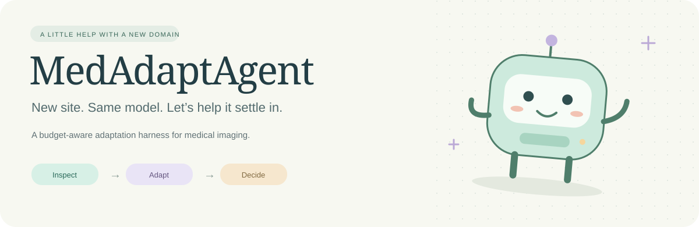
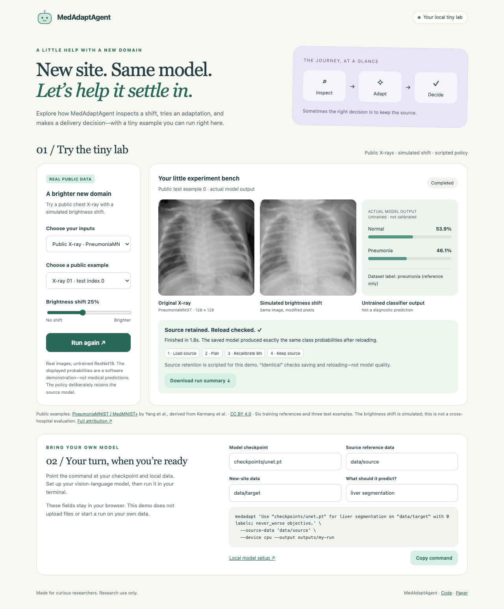
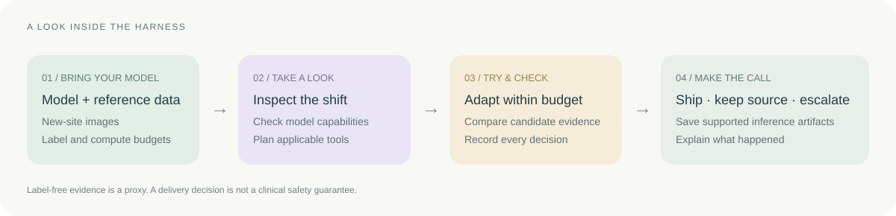

<p align="center">
  
</p>

<p align="center">
  <strong>An Automatic Harness for Adapting Medical Imaging Models to New Sites</strong><br>
  Hanxue Gu · Zhonghao Liu · Xingrui Gu · Kang Wang · Yang Yang
</p>

<p align="center">
  🎉 <strong>Accepted as a poster at GenAI4Health 2026, a NeurIPS 2026 workshop.</strong>
</p>

<p align="center">
  <a href="paper/MedAdaptAgent_camera_ready.pdf">📄 Read the paper</a> &nbsp;·&nbsp;
  <a href="#-meet-the-tiny-lab">🌱 Try the demo</a> &nbsp;·&nbsp;
  <a href="docs/LOCAL_LLM.md">🏡 Use a local model</a> &nbsp;·&nbsp;
  <a href="docs/DATA.md">🧩 Bring your data</a>
</p>

---

Your model knows one hospital. Now you want to use it somewhere new.

**MedAdaptAgent helps you explore that move.** It inspects the new domain, chooses tools that fit your model, and works within your label and compute budgets. At the end, it can deliver an adaptation, keep the original model, or explain why it needs to stop.

Sometimes keeping the source is the right call. That’s part of the workflow, too.

## 🌱 Meet the tiny lab

A small, local playground with **real public chest X-rays from PneumoniaMNIST**. A few attributed examples are bundled, so you need no private data, API key, or model download.

<p align="center">
  <a href="docs/DEMO.md"></a>
</p>

**Choose a brightness shift → run the harness → see the output → check the reload.**

Choose one of three real 128 × 128 X-rays, adjust a **simulated** brightness shift, and run the classification harness. The page shows the original image, modified image, dataset label, and actual output probabilities from an **untrained ResNet18**. The original synthetic-shape demo is still available in the selector.

The policy is scripted and deliberately retains the source. This checks adaptation software and saved-model reload—not medical performance or LLM reasoning. Public samples are from [MedMNIST+](https://doi.org/10.5281/zenodo.10519652), distributed under [CC BY 4.0](https://creativecommons.org/licenses/by/4.0/); see [full attribution and exact sample indices](medadaptagent/demo/samples/ATTRIBUTION.md).

```sh
git clone https://github.com/Guhanxue/medagent.git
cd medagent
python3 -m venv .venv
source .venv/bin/activate
python -m pip install -e .
medadapt-demo
```

Your browser opens at **http://127.0.0.1:8765**. The demo runs on CPU and stays on your machine. You can download a small run summary or build a command for your own data. [Take the guided tour →](docs/DEMO.md)

<details>
<summary>Prefer the terminal? Or need another port?</summary>

```sh
python examples/smoke_workflow.py
medadapt-demo --port 8766 --no-browser
```

Python 3.10–3.12 is supported. For GPU use, install a suitable PyTorch build first. Optional model families need `python -m pip install -e '.[models]'` and their own weights.

</details>

## 🧭 How it works



The planner picks from the tools available for the task. The harness tracks the budget and evidence, applies the selection rules, and records what happened. A successful delivery includes weights, an inference script, and a report.

| What you bring | What you get back |
| --- | --- |
| A compatible source checkpoint | A delivery decision and its reasoning |
| Source reference and new-site images | A trace of the tools that ran |
| A label and compute budget | An inference package when delivery succeeds |

## 🏡 Give it a local vision-language model

Ready to move beyond the scripted demo? Start [Ollama](https://ollama.com/), then:

```sh
ollama pull qwen3-vl:4b-instruct
export MEDADAPT_LLM_BACKEND=local
export MEDADAPT_LLM_BASE_URL=http://127.0.0.1:11434/v1
export MEDADAPT_LLM_MODEL=qwen3-vl:4b-instruct
medadapt --check-llm
```

This checks the connection with a synthetic image. Vision support matters because the workflow can use image-based critique. No institutional key is included or required for the local option. [Other endpoints and setup details →](docs/LOCAL_LLM.md)

## 🧩 Bring your own model

Once your checkpoint, data and LLM endpoint are ready:

```sh
medadapt 'Use checkpoints/unet.pt for liver segmentation on data/target with 0 labels; never_worse objective.' \
  --source-data data/source \
  --device cpu \
  --minutes 30 --trials 8 \
  --output outputs/liver
```

Start with the [input formats and checkpoint notes](docs/DATA.md). The current command supports compatible **2D segmentation and classification** checkpoints. Use `--device cuda:0` on a configured CUDA machine.

Look in `outputs/liver/run.json` for the status, decision, and trace. A successful delivery also writes a model package. An `escalate` decision means no model was delivered.

## 🌿 Public-model deployments

**Seven public-model configurations produce runnable inference packages**, with identical predictions on all ten test scans after reload. Five select an adapted model; two retain the pretrained model.

| Model and target | Labels | Pretrained Dice | Delivered Dice | Selected model |
| --- | ---: | ---: | ---: | --- |
| U-Net → TotalSegmentator CT | 5 | 0.386 | 0.386 | Pretrained |
| SwinUNETR → TotalSegmentator CT | 5 | 0.669 | 0.705 | LoRA |
| SegResNet → MSD spleen CT | 5 | 0.951 | 0.951 | Pretrained |
| U-Net → AMOS MRI | 5 | 0.000 | 0.120 | Tent |
| U-Net → AMOS MRI | 20 | 0.000 | 0.233 | LoRA |
| SwinUNETR → AMOS MRI | 5 | 0.040 | 0.191 | Partial fine-tuning |
| SwinUNETR → AMOS MRI | 20 | 0.040 | 0.264 | Partial fine-tuning |

Dice is measured against expert annotations on ten test scans excluded from training and model selection. [Run the public-model workflow →](docs/PUBLIC_MODELS.md) · [Explore the results →](results/public_model_attempts.json)

**Evaluated with four LLM planners:** GPT-5.2, GPT-5.6 Luna, Qwen3-VL-4B, and Qwen3-VL-8B. All four deliver adapted models with exact prediction agreement after reload on the same CT-to-MRI task. The broader benchmarks use GPT-5.2. [See the planner comparison →](docs/PLANNERS.md)

## 🗂 Find your way around

| Folder | What lives here |
| --- | --- |
| [`harness/`](harness/) | The decision loop, budgets, task adapters and delivery |
| [`medadaptagent/`](medadaptagent/) | Model wrappers, adaptation tools, LLM client and demo |
| [`examples/`](examples/) · [`tests/`](tests/) | Small runnable examples and software checks |
| [`scripts/`](scripts/) | Shared loaders and reference benchmark runners |
| [`results/`](results/) | Saved result records—summarize with `python summarize_results.py` |
| [`paper/`](paper/) | The camera-ready PDF |

<details>
<summary>🔬 Scope, checks, and a few useful boundaries</summary>

- The offline checks cover core decisions, budgets, credential isolation, model loading, segmentation/classification reload, and fitted preprocessing. Run `python -m pip install -e '.[dev]'` followed by `python scripts/check_release.py`.
- The browser demo uses an untrained model and a scripted policy. A separate [planner comparison](docs/PLANNERS.md) evaluates GPT-5.2, GPT-5.6 Luna, and two public Qwen planners on a real CT-to-MRI adaptation task, with GPT-5.2 image analysis and critique shared across conditions.
- Label-free evidence is a proxy, not measured Dice/AUROC. `never_worse` is the name of a selection policy, not a clinical safety guarantee. Budgets use harness accounting rather than strict wall-clock or provider billing limits.
- The [3D public-model runner](docs/PUBLIC_MODELS.md) includes bundle-specific preprocessing and a tested package loader. The generic `medadapt` command remains scoped to 2D tasks.
- See [supported workflows and package formats](docs/RELEASE.md) for implementation details.
- Only nine attributed public dataset images are bundled for the demo; no private medical data, pretrained weights or author credentials are included. Runtime artifacts stay local and may contain reference-image information. See [credential handling](SECURITY.md).
- The source code is released under [Apache 2.0](LICENSE). Dataset samples retain their [CC BY 4.0 attribution](medadaptagent/demo/samples/ATTRIBUTION.md); model and dataset licenses apply separately.

</details>

<p align="center"><sub>Made for curious researchers. One new domain at a time. 🌿</sub></p>
